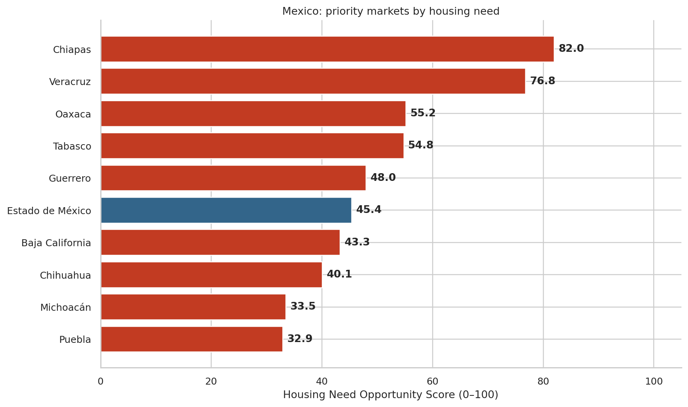
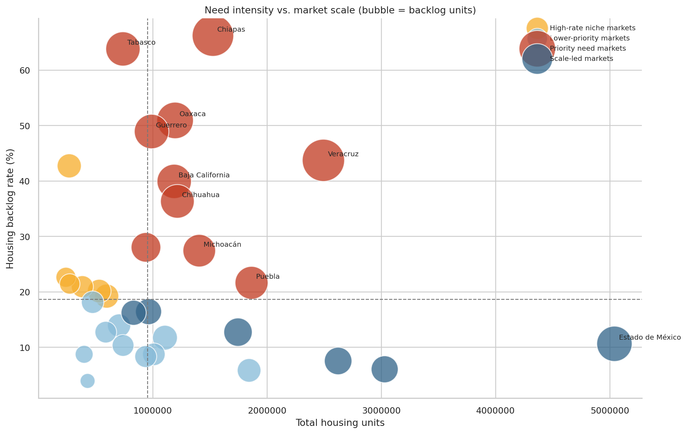
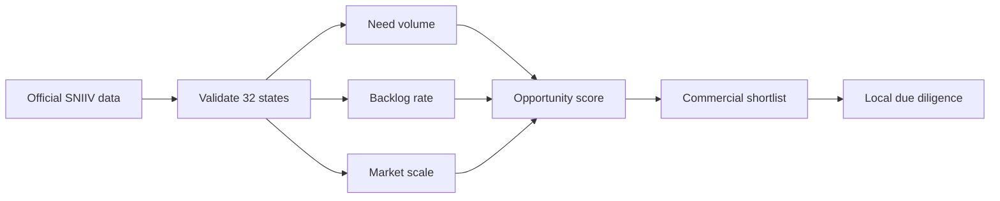

# Mexico Real Estate Market Intelligence


A real-data market-screening project that helps developers, housing-finance providers and real-estate service companies identify Mexican states where housing need deserves deeper commercial evaluation.

> **Business question:** Which states combine the greatest housing need, the highest need intensity and sufficient market scale to enter a commercial opportunity pipeline?

## Executive result

The official 2024 SNIIV dataset represents **38.36 million housing units**, of which **8.38 million (21.9%)** were classified as being in housing backlog.

| Rank | State | Score | Backlog units | Backlog rate |
|---:|---|---:|---:|---:|
| 1 | Chiapas | 82.0 | 1,010,514 | 66.2% |
| 2 | Veracruz | 76.8 | 1,090,501 | 43.7% |
| 3 | Oaxaca | 55.2 | 608,586 | 50.9% |
| 4 | Tabasco | 54.8 | 472,099 | 63.8% |
| 5 | Guerrero | 48.0 | 484,667 | 48.9% |



### What the pattern means

- **Chiapas and Veracruz** combine exceptional absolute need with high backlog rates.
- **Oaxaca, Tabasco and Guerrero** show intense unmet need at commercially meaningful scale.
- **Estado de México** is a scale-led opportunity: its 10.6% backlog rate is lower, but the absolute need still exceeds 533 thousand homes.
- The score is a **screening tool, not an investment forecast**. High-ranking markets require deeper validation of income, prices, land, regulation, absorption and financing.



## Data: public, official and traceable

Core data comes from the [SNIIV open-data portal](https://sniiv.sedatu.gob.mx/Reporte/Datos_abiertos), operated by Mexico's Secretaría de Desarrollo Agrario, Territorial y Urbano (SEDATU):

- Dataset: **Rezago habitacional 2024**
- Geography: all 32 federal entities
- Unit: housing units
- Retrieval date: 5 October 2026
- Original official share: [download/view source file](https://sistemas.sedatu.gob.mx/repositorio/s/HXsrMcyMS_iLS0Mk3ezWVQ)

National context is drawn from Sociedad Hipotecaria Federal (SHF):

- [Demanda de vivienda 2026](https://www.gob.mx/shf/documentos/demanda-de-vivienda-2026): 864,290 expected housing financings.
- [Índice SHF de Precios de la Vivienda, Q2 2026](https://www.gob.mx/shf/articulos/indice-shf-de-precios-de-la-vivienda-en-mexico-segundo-trimestre-de-2026?idiom=es): 7.3% annual national appreciation.

The SHF indicators are contextual and do not enter the state score.

## Transparent opportunity score

The analysis min-max normalizes three variables and applies explicit weights:

| Component | Weight | Rationale |
|---|---:|---|
| Backlog units | 45% | Absolute addressable need |
| Backlog rate | 35% | Intensity of unmet conditions |
| Total housing units | 20% | Market scale |

Full definitions, segmentation and limitations are documented in [the methodology](docs/methodology.md).

## Repository structure

```text
├── data/
│   ├── raw/                 # Transcribed official SNIIV state totals
│   ├── processed/           # Analysis and Power BI-ready tables
│   └── source_manifest.csv  # Source, period, link and use
├── docs/                    # Methodology and data dictionary
├── powerbi/                 # Dashboard layout and DAX measures
├── reports/                 # Executive summary and figures
├── src/build_analysis.py    # Reproducible pipeline
└── tests/test_outputs.py    # Integrity and reconciliation tests
```

## Reproduce the analysis

```bash
python -m venv .venv
source .venv/bin/activate        # Windows: .venv\Scripts\activate
pip install -r requirements.txt
python src/build_analysis.py
python -m unittest discover -s tests -v
```

The script rebuilds the processed datasets, figures and executive summary. `powerbi/dashboard_spec.md` contains the model, recommended visuals and DAX measures for a Power BI implementation.

## Decision framework



## Responsible use

Housing backlog measures social and physical housing need; it does not by itself prove purchasing power or project profitability. This project deliberately keeps those concepts separate. See [methodology and limitations](docs/methodology.md) before using the ranking.

## Author

**André Luiz Monte** — Commercial Leadership · Business Development · Data Analytics · Market Intelligence

## License

MIT. Source data remains subject to the terms of the respective public institutions and should be cited to SNIIV/SEDATU and SHF.
